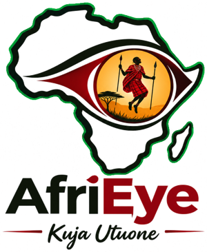
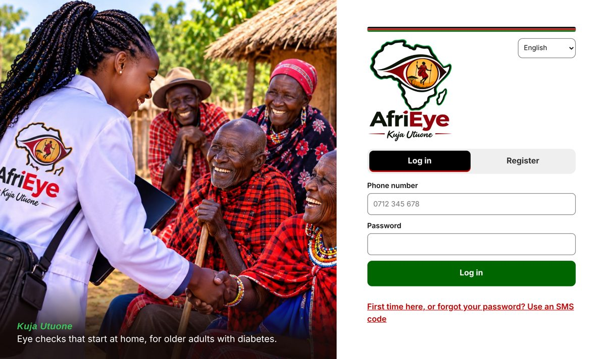
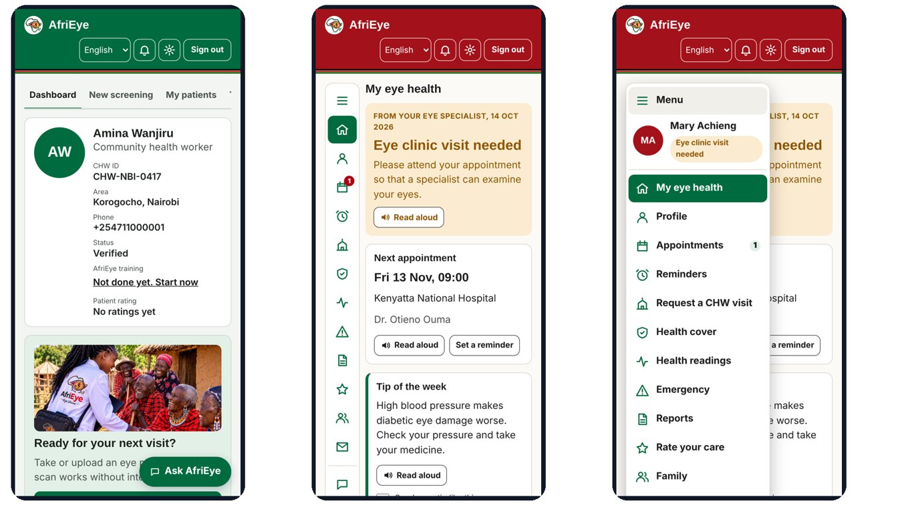
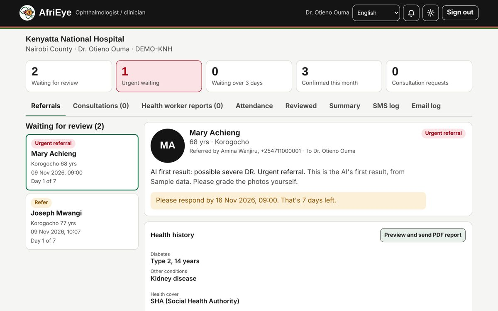
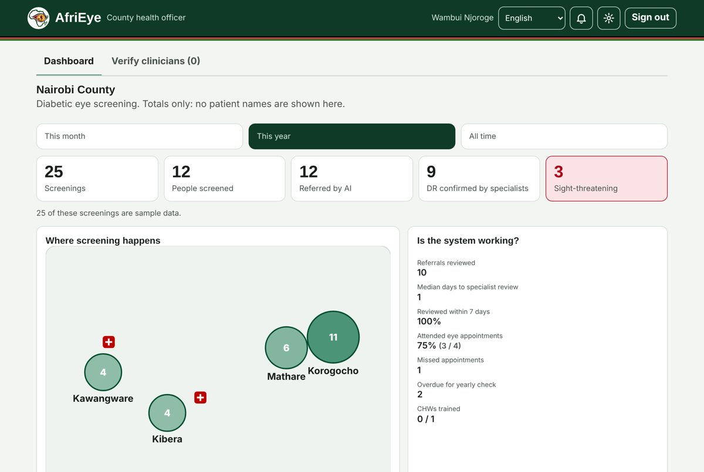
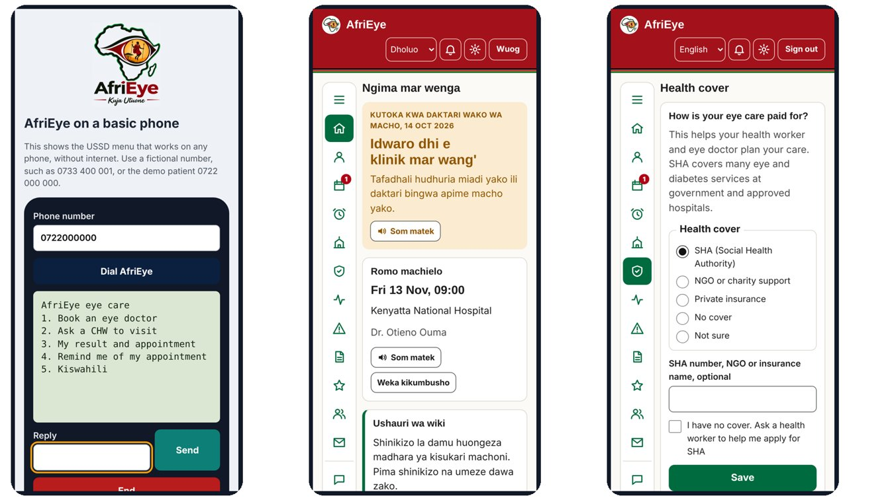

<p align="center"></p>

<h1 align="center">AfriEye</h1>
<p align="center"><b>Kuja Utuone</b>: come, let us see you</p>
<p align="center">An AI model and an app that help community health workers in Kenya find older adults with diabetes who need an eye specialist, before they lose their sight.</p>
<p align="center"><a href="https://afrieye.pythonanywhere.com"><b>Try the live demo</b></a> · Team empOUR · Samsung Innovation Campus, Artificial Intelligence Course</p>

> **Research prototype, not a medical device.** All people and records in the demo are fictional. Don't enter real patient data.



## The problem

Diabetic retinopathy can damage the eyes with no pain and no early signs, and treatment works best before sight is lost. In Kenya, eye checks and specialists are far from where many older adults with diabetes live:

- At Kitale, only **18%** of diabetic clinic patients were screened for diabetic retinopathy (OEU Kenya, 2018).
- In a three-county study, only **13%** had an eye exam in the past year, and only **24%** had been referred by their diabetes service (Mwangi et al., 2017).

## What AfriEye does

AfriEye is two things. We make no hardware: photos come from an ordinary smartphone with a retinal adapter already on the market.

1. **An AI model** (EfficientNet-B0) that reads a photo of the back of the eye **on the phone, even without internet**, and returns refer, urgent, retake or recheck.
2. **An app** that connects the community health worker (CHW), the eye specialist, the patient's family and the county health office, and follows each patient round a complete loop:

| Step | What happens |
| --- | --- |
| 1. Screen at home | The CHW records consent, health history, blood sugar and blood pressure, then photographs each eye with live camera tips |
| 2. AI first result | On the phone, offline, in seconds |
| 3. Specialist decides | The nearest hospital's specialist grades the photos within 7 days (alert at day 3, hospital emailed at day 7) |
| 4. Patient and family told | SMS, email, USSD on any phone, or the app, with read-aloud |
| 5. Attend and treat | The clinic marks attendance and records treatment; a missed visit goes back to the CHW |
| 6. Next check | Recall after 12 months, or 6 months for early changes; the county sees the totals |

**The AI never decides alone.** The eye specialist makes every decision, and reports are checked by a specialist before the patient sees them.

## Four connected workspaces



| Role | What they see |
| --- | --- |
| **Community health worker** | Screening with on-device AI, referrals to the nearest hospital, missed appointments, people due for a check, village visit requests, SHA help, training and certificate |
| **Eye specialist** | Referral queue with a 7-day countdown, photos and AI scores, health history and readings, appointment booking, attendance, treatment, CHW reports to check, AI-versus-specialist agreement |
| **Patient and family** | Result, appointments, reminders, emergency signs, reports to share, health readings, SHA cover, CHW visit requests, ratings |
| **County health officer** | Totals only, never names: a map of screenings by area, review times, attendance, treatments, rechecks overdue; verifies new clinicians' licences |




## Built for Kenya



- **Any phone:** USSD and SMS to book an eye doctor, ask a CHW to visit, hear a result or set a reminder.
- **13 languages:** English and Kiswahili, plus drafts in Dholuo, Gĩkũyũ, Kĩkamba and Somali; other Kenyan languages show Kiswahili until translated. Drafts still need native-speaker review.
- **Read aloud** in a soft Kenyan woman's voice where the device has one (for example, Microsoft Edge).
- **Village visits:** request a CHW for a home visit or a whole-village eye check.
- **SHA help:** records each patient's health cover, and CHWs help people with no cover apply for SHA.
- **Kenyan colours** throughout, and a theme, text size and font of each user's choosing.

## Safety and trust

- New clinicians can't see patients until their **county health office checks their licence** (KMPDC or Clinical Officers Council register).
- Consent before every photo; every view of a record is audited; patients can download or delete their data.
- The county dashboard shows totals only. Designed with Kenya's Data Protection Act (2019) in mind; registration with the Data Commissioner comes before any real patient data.

## Model results

Trained on 1,200 retinal photos and tested on 400 photos from **100 unseen patients** in the public DeepDRiD dataset. Eight models were compared on the same patients, and the final model was chosen on validation data only.

| Model | Test AUC | Sensitivity | Specificity | Severe photos missed | Size |
| --- | --- | --- | --- | --- | --- |
| ConvNeXt-Tiny | 0.978 | 89% | 94% | 6 of 92 | 111 MB |
| MobileNetV3 | 0.972 | 93% | 90% | 5 of 92 | 17 MB |
| **EfficientNet-B0 (chosen)** | **0.969** | **93%** | **87%** | **1 of 92** | **16 MB** |
| Small CNN | 0.943 | 95% | 78% | 2 of 92 | 0.7 MB |
| XGBoost | 0.889 | 95% | 67% | 7 of 92 | – |

**An honest limit:** part of the score may come from the camera. In this dataset, larger photos are far more often referable, and EfficientNet-B0's AUC falls from 0.975 on smaller photos to 0.889 on larger ones. The model has not yet been tested on adapter photos or Kenyan patients.

## Try it

**Online:** [afrieye.pythonanywhere.com](https://afrieye.pythonanywhere.com)

| Role | Phone | Password |
| --- | --- | --- |
| Patient | 0722 000 000 | demo-patient-2026 |
| Community health worker | 0711 000 001 | demo-chw-2026 |
| Eye specialist | 0711 000 002 | demo-eye-2026 |
| County health officer | 0711 000 003 | demo-county-2026 |

The shared demo accounts are locked, so their passwords can't be changed. Register your own account to try every step. SMS, email and USSD run in test mode.

**On your computer** (Python 3.11 or later):

```bash
python -m venv .venv
.venv\Scripts\activate          # Windows; on Mac or Linux: source .venv/bin/activate
pip install -r requirements-app.txt
python app/run.py
```

Then open http://localhost:8200. The USSD simulator is at http://localhost:8200/static/ussd.html.

Run the tests with `python -m pytest app/tests`.

## Project layout

| Folder | What's in it |
| --- | --- |
| `app/` | The Flask server, the web app, the on-device model, translations and tests |
| `notebooks/` | Data, training and evaluation notebooks, from data preparation to exporting the model for the phone |
| `results/` | Metrics for every model compared |
| `docs/` | Model decisions, the adapter test plan, and screenshots |
| `branding/` | The AfriEye logo |

## Roadmap

1. **Months 0–3:** interview CHWs and clinicians; test 2 retinal adapters with an eye specialist; send a first real SMS.
2. **Months 3–9:** ethics approval; consented Kenyan photos; retrain and retest; register with the Data Commissioner.
3. **Months 9–18:** a silent pilot where specialists grade blind; Pharmacy and Poisons Board submission.
4. **Months 18–36:** paid sites after approval; other eye conditions; links with SHA and national health records.

## Team empOUR

Audry Saisi · Grace Eva · Eva Muthoni · Hailey Wanjiru · Tabitha Wangeshi

Samsung Innovation Campus, Artificial Intelligence Course, 2026.

## Acknowledgements

- Retinal photos: **DeepDRiD**, Liu R. et al., *Patterns* (2022), licensed CC BY-SA 4.0.
- Statistics: OEU Kenya Kitale DR study (2018); Mwangi N. et al., *Tropical Medicine and Health* (2017); IDF Diabetes Atlas, Kenya (2024).
- Open-source tools: PyTorch, ONNX Runtime Web, Flask, ReportLab, PDF.js.
